# First results

2026-10-17 (suburban runs redone the same day after a map-edge fix). Single-season experiments use 20 seeds; multi-year experiments use 30. Each season has 500 mothers with 8 ducklings each, on a 1.2 km square. Unless stated otherwise the water is a shoreline along the south edge, and mothers use the greedy navigator (they know which way the water is, and nothing else). Error bars and ± values are one standard error across seeds. Many parameters are still placeholders (see PLAN.md, "Parameter provenance"), so the absolute percentages below should be read as illustrations; the comparisons between layouts are what the model is for.

Regenerate everything with:

```bash
node src/experiment/cli.js all --seeds 1-20
node src/experiment/cli.js run e9-species-years,e10-evolution --seeds 1-30
node src/experiment/snapshot.js gallery
python3 analysis/plots.py && python3 analysis/maps.py
```

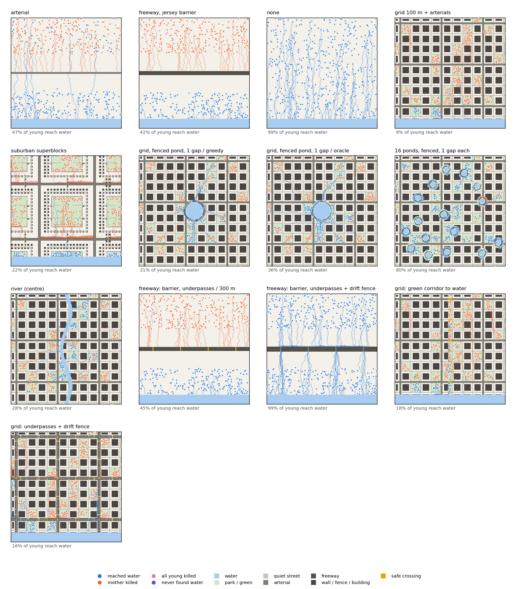

Each map shows one season. Dots are nests, coloured by what happened to the brood; lines are a sample of the walks.

## E1. One road

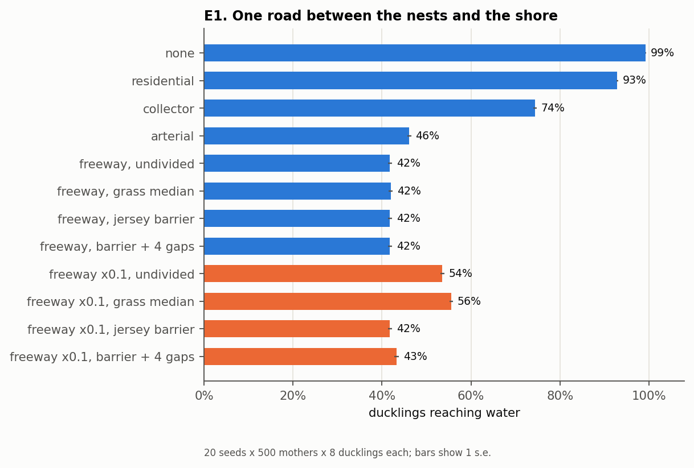

With no roads, 99.3% of ducklings reach the shore. A single road across the middle (so about half the nests are on the far side) leaves 93% with a quiet residential street, 74% with a collector, and 46% with a four-lane arterial. At default freeway volumes almost nothing north of the road survives eight lanes, so all four freeway designs land at 42%, which is the share of ducklings that hatched south of it.

At a tenth of the freeway traffic the median design matters. An undivided freeway lets 54% through, a grass median 56% (the brood can stop between carriageways), and a jersey barrier 42%, which means no brood from the north side survives. The greedy mother reaches the barrier, cannot cross it, and walks along it on the inner lane until she is hit. Four gaps in the barrier recover only 1.5 points, because a mother who cannot see the gaps rarely finds one before she is killed. This is the duck in the HOV lane.

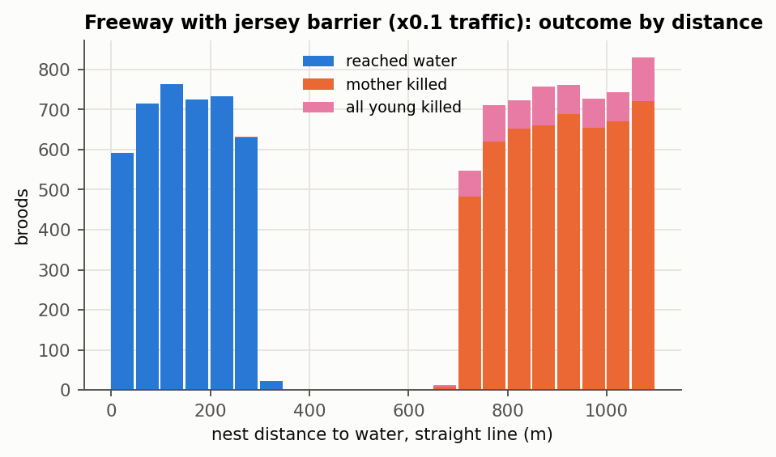

## E2. Urban form

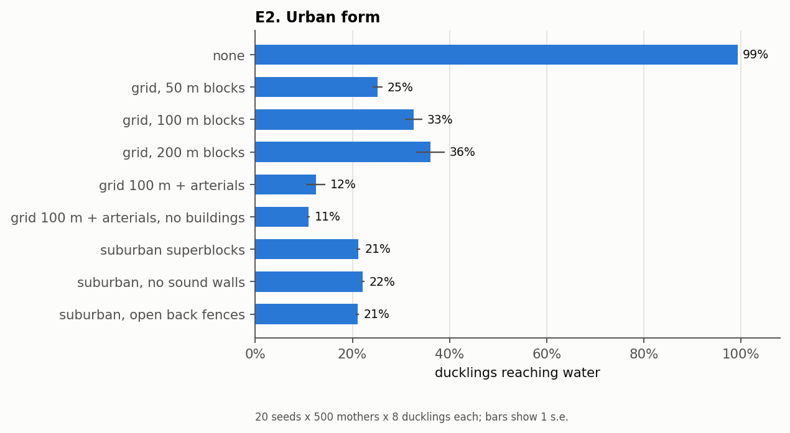

On a grid of quiet streets, smaller blocks are worse (25% of ducklings arrive with 50 m blocks, 33% with 100 m, 36% with 200 m), because a walk of fixed length crosses more streets. Adding an arterial every fourth street cuts the 100 m grid to 12.5%. The suburban superblock layout reaches 21%. Removing its sound walls or opening most back-yard gates changed that by about 1 point, because the arterial crossing dominates either way. (An earlier version of the suburban map had superblocks cut off by the map edge with no street out of them, and 14% of broods paced inside them until time ran out. The connector streets now sit in the visible part of each superblock, and no brood times out.)

Most broods arrive whole or not at all, because a dead mother means a lost brood:

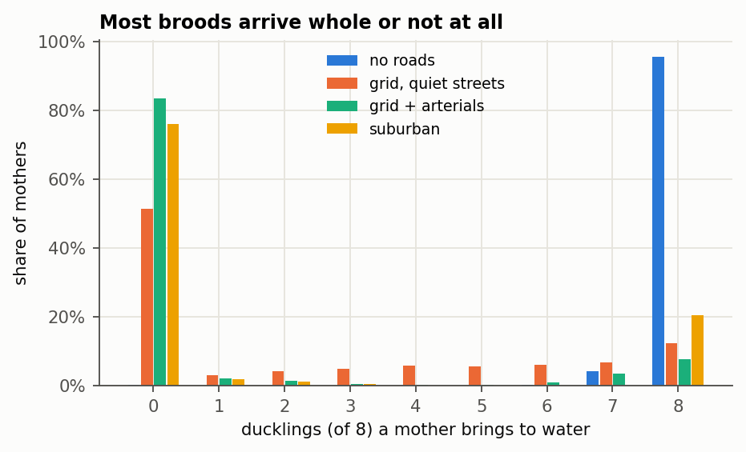

## E3. The cost of not knowing the map

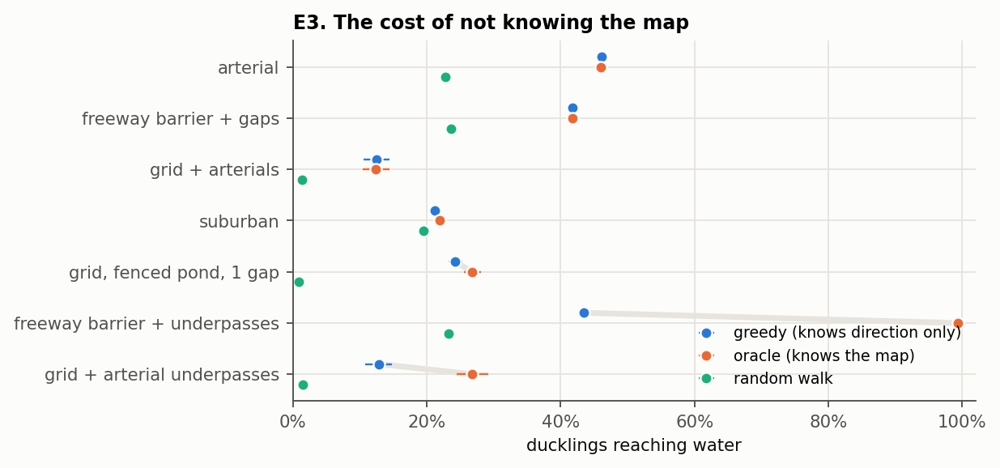

The oracle navigator knows the map and takes the safest route; it is an upper bound for any bird. With a straight shoreline and roads across the way, it does no better than the greedy mother (12.4% vs 12.5% on the grid with arterials), because every route crosses the same roads. Knowing the map pays off only where a safe route exists. Under a freeway with tunnels every 300 m but no fence to steer birds into them, the greedy mother gets 43% of ducklings to water and the oracle gets 99%. On the grid with arterial tunnels the numbers are 13% and 27%.

This matches the finding of a meta-analysis of road mitigation studies that crossing structures without fencing had no detectable effect on road-kill, while fencing reduced it by 54% (Rytwinski et al. 2016). In the model the mechanism is that the bird does not know the tunnel exists.

## E4. Where the water is

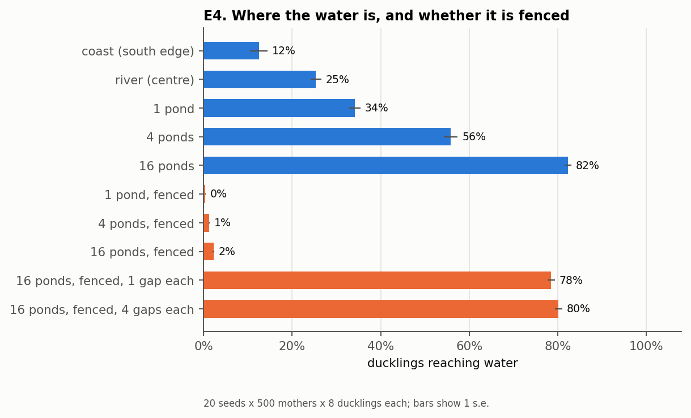

Holding total water area fixed at 1,600 cells (4 ha) on the grid with arterials, one central pond gets 34% of ducklings to water, four ponds 56%, and sixteen ponds 82%, because the nearest water is closer. Fencing the ponds with no gaps drops all three to between 0.4% and 2%. One 15 m gap per fence brings the sixteen ponds back to 79%, and four gaps to 80%. A single gap in each fence recovers almost everything, which is the hole under the chain-link from the geese story.

## E5. Mitigation

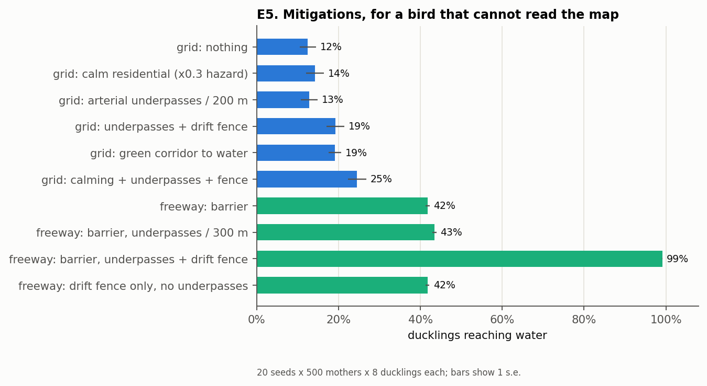

At the barrier freeway, tunnels alone raise arrivals from 42% to 43%. A drift fence alone (a fence along the road with no tunnels) leaves 42%, but now the northern mothers never reach the road, so they survive even though their broods do not. Tunnels and a drift fence together reach 99%.

On the grid, each intervention helps a little (calming residential traffic to 30% of its hazard: 14%; fenced arterial tunnels: 19%; a green corridor down the middle: 19%), and the three combined reach 25%. The grid has too many roads for any one fix.

## E6. Where to put a fixed number of crossings

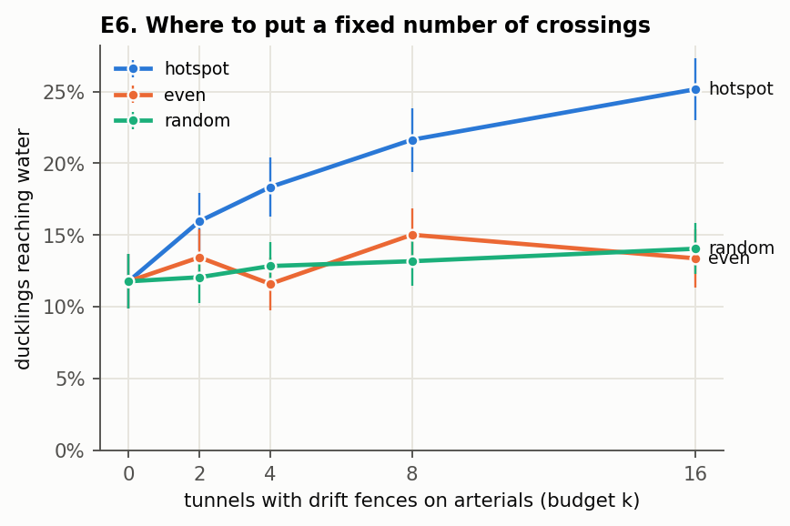

Crossings (each with a drift fence) were placed on the grid's arterials in three ways. "Hotspot" runs a pilot season with a different cohort, counts road deaths along each arterial, and puts crossings at the deadliest stretches, which is how crossings are often sited from roadkill surveys. With 16 crossings, hotspot siting raised arrivals from 12% to 25%; even spacing reached 13% and random placement 14%.

## E7. Theory against simulation

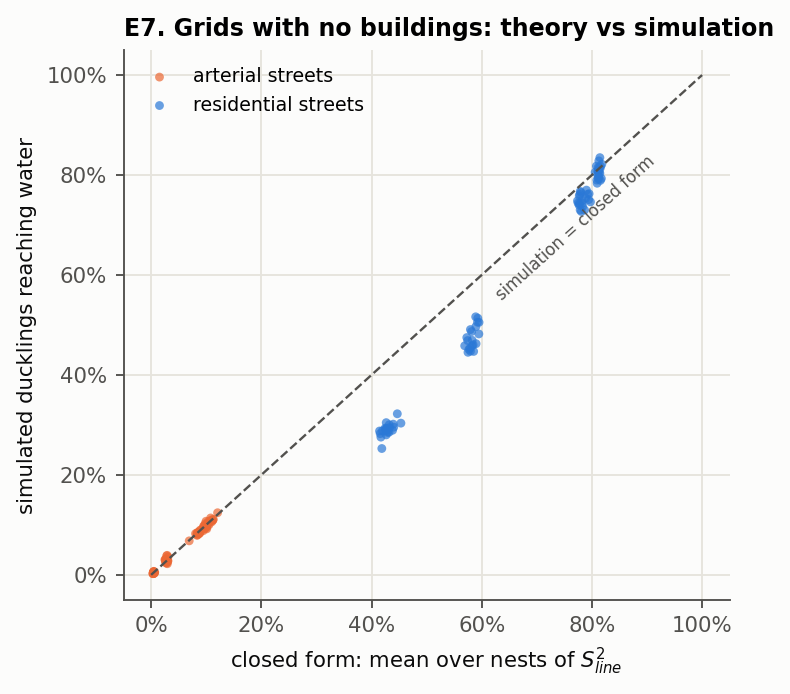

On grids with no buildings, a straight walk to the shore crosses a predictable number of streets (L / s for a walk of length L perpendicular to streets spaced s apart, or 4L / (πs) for a random heading, the Buffon / Cauchy-Crofton result). The expected fraction of ducklings arriving is then S², where S is one bird's survival along the line (the duckling and its mother both have to survive). For arterials the simulation sits on the formula. For residential streets it falls below it, by up to 14 points with 50 m blocks. The cause is in the brood records. On quiet streets a mother wanders into streets that run toward the water and walks along them, since a diagonal step costs her no progress. Mothers that arrived spent on average 19 ticks on road cells, where the straight line crosses 12. On arterials the mothers that lingered did not survive, so the survivors' road time matches the straight line.

## E8. Species, one season

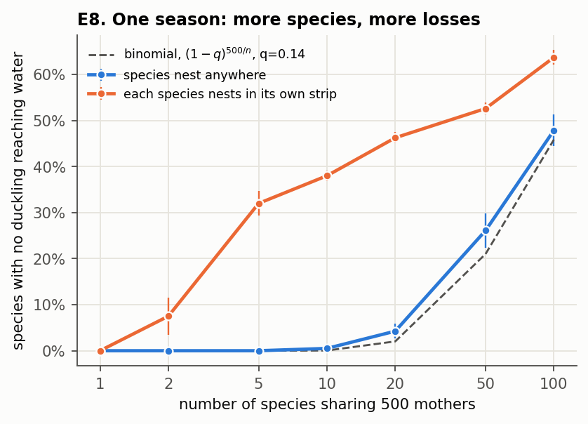

The 500 mothers are split evenly among n species, and a species is counted as lost for the season if none of its ducklings reach water. With species mixed in space, the count follows the binomial formula n(1 - q)^(500/n), where q (14%) is the chance that a brood succeeds: almost no losses up to 20 species, then 13 of 50 and 48 of 100. This is the "simple math" version of the hypothesis that more species means more extinctions.

When each species nests in its own vertical strip (with the water along the east edge, so the strips differ in distance to water), losses rise sharply at every n: 1.6 of 5 species, 9.3 of 20, 26 of 50. The excess over the binomial line comes from correlated risk: species in the far strips fail together.

## E9. Species over 30 years

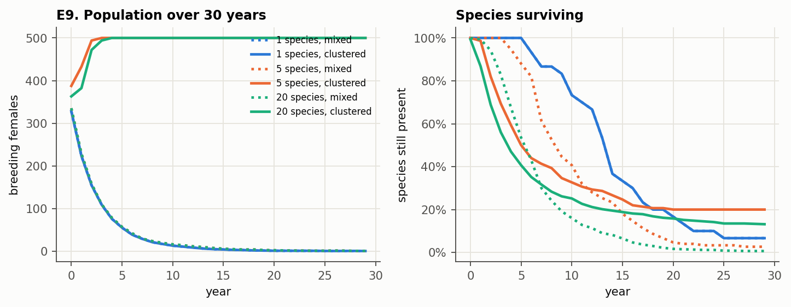

On a grid of quiet streets with the water to the east, a single mixed population declines to extinction in about 16 years in 28 of 30 runs. When species nest in their own strips, the total population persists in all 30 runs, but only because the one or two species nearest the water fill the landscape: an average of 1 of 5 and 2.6 of 20 species remain at year 30. Spatial structure saves the population and loses most of the species.

## E10. Can nest choice evolve fast enough?

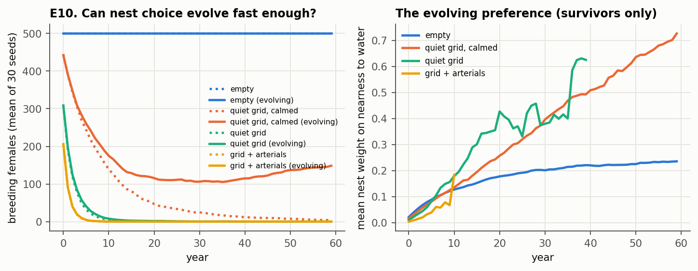

Here nest predation is on (nests near roads and near the shore lose more eggs), and each mother carries a heritable weight on nearness to water, which starts at zero and mutates. The browser view can run this: pick `e10-evolution`, and generations mode switches on.

With no roads, the population sits at capacity either way. On the grid with arterials it goes extinct in about 9 years whether or not the preference can evolve. On the grid of quiet streets, evolution extends survival from 14 to 19 years but every run still goes extinct. On the same grid with traffic calmed, 5 of 30 non-evolving populations survived 60 years, against 24 of 30 evolving ones, whose mean weight on water rose from 0 to about 0.7.

Why evolution only delays extinction on the quiet grid comes out of the yearly records (means over the 30 runs). A population replaces itself when about 2.7 young per breeding female reach water (adult survival 0.6, plus 0.15 recruits per arriving duckling). The preference rises at about the same pace in both landscapes, roughly 0.015 per year, because the mutation size sets how fast variation appears. What differs is how long the population has.

| year | quiet grid: females | weight on water | young per female | calmed grid: females | weight on water | young per female |
|---|---|---|---|---|---|---|
| 0 | 309 | 0.01 | 1.15 | 442 | 0.02 | 2.38 |
| 6 | 28 | 0.10 | 1.33 | 242 | 0.09 | 2.46 |
| 12 / 10 | 6 | 0.22 | 1.73 | 175 | 0.14 | 2.41 |
| 18 / 20 | 5 | 0.35 | 2.24 | 116 | 0.26 | 2.60 |
| 30 | (7 of 30 left at year 21) | | | 114 | 0.40 | 2.74 |
| 59 | | | | 178 | 0.73 | 3.09 |

On the quiet grid the population loses about 60% a year at first, so by the time selection has pushed the young per female from 1.2 up to 2.2, only about five females are left, and a bad year or two at that size ends it. On the calmed grid the population loses about 10% a year, bottoms out near 114 females around year 25, and climbs back once the young per female passes replacement. This U-shaped trajectory is the standard picture of evolutionary rescue (a race between decline and adaptation). The model's version of it has a planning reading: calming traffic did not by itself save most populations (5 of 30), but it slowed the decline enough for the birds' own adaptation to finish the job (24 of 30).

## S1, S2. Sensitivity

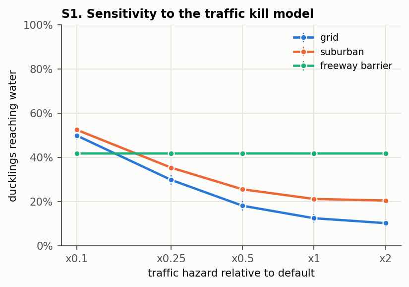

Scaling every road's hazard from x0.1 to x2 moves the grid from 50% to 10% and the suburb from 52% to 20%, and the grid is worse than the suburb at every setting. The barrier freeway is flat at 42% at every traffic level, since no brood crosses the barrier anyway. Changing the greedy navigator's noise and memory over a wide range, or making the mother keep walking in the direction she was going along a fence (heading persistence 2 or 4), moved the suburban result by less than 1 point (S2).

## What these results do not yet show

- None of the absolute rates are calibrated. The traffic kill model, juvenile survival, and nest survival are placeholders.
- All layouts are stylised. Whether real street networks behave like the grid or the superblock is untested (OSM import is the next step).
- Broods never split, curbs are not modelled, and mothers have no memory across years.
